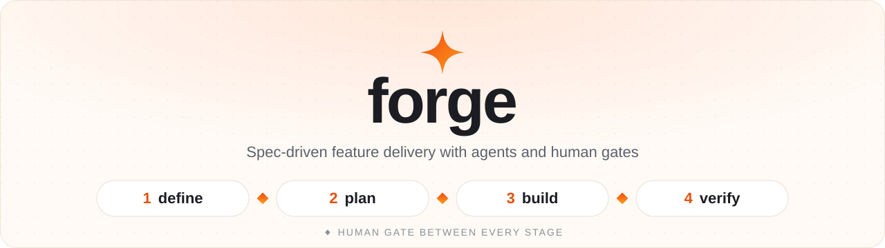
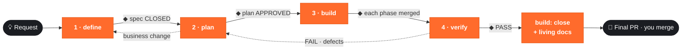

<div align="center">

<picture>
  <source media="(prefers-color-scheme: dark)" srcset="assets/banner-dark.svg">
  <source media="(prefers-color-scheme: light)" srcset="assets/banner-light.svg">
  
</picture>

<br/>

[](LICENSE)
[](CHANGELOG.md)
[](https://claude.com/claude-code)
[](#-contributing)

**Turn a feature request into shipped, tested and documented code, with AI agents doing the work and you approving every step.**

[Install](#-install) · [Quick start](#-quick-start) · [How it works](#-how-it-works) · [Docs](#-documentation) · [Example](examples/)

</div>

---

## ✨ Why forge

<table>
<tr>
<td width="50%" valign="top">

### 🛡️ You stay in control
Nothing advances without your approval. You close the spec, approve the plan, approve each phase and accept the QA verdict. forge **never** merges to your main branch or deploys.

</td>
<td width="50%" valign="top">

### 🎯 The right model for each task
The plan assigns Haiku, Sonnet or Opus to each task and estimates the cost. The build pauses when a task or phase goes over budget.

</td>
</tr>
<tr>
<td width="50%" valign="top">

### 🔍 QA that does not trust the code
Expected results come from the spec, never from the code under test. Every rule is traced to a test case, and the test suite itself gets reviewed.

</td>
<td width="50%" valign="top">

### 📚 Docs that stay true
When a feature closes, its rules are merged into **living functional docs** that describe how the system works *today*. Per-feature work files are removed, and git keeps them.

</td>
</tr>
</table>

> 🌍 **Works in your language.** The skills are written in English. The first time you use one in a repo, it asks which language the team works in and saves the answer in `CLAUDE.md`. From then on, every conversation and document uses that language.

## 🧭 How it works

Four skills, one job each, with a human gate between them:

| | Skill | Acts as | Produces | Never |
|:-:|---|---|---|---|
| **1** | [`/forge:define`](skills/define/SKILL.md) | Product Owner | `spec.md`: rules, edge cases, inputs, outputs, worked examples | writes code or decides for you |
| **2** | [`/forge:plan`](skills/plan/SKILL.md) | Tech & AI Lead | `plan.md`: phases, tasks, agent/model/effort per task, cost, branches, rollback | writes code |
| **3** | [`/forge:build`](skills/build/SKILL.md) | Orchestrator | Code from parallel agents, a commit and tests per task, a PR per phase | merges to main or deploys |
| **4** | [`/forge:verify`](skills/verify/SKILL.md) | Senior QA | `qa.md`: traced test cases, evidence, defects, verdict | fixes code |



### 🗓️ Meetings flow

Three more skills, independent from the flow above, turn a meeting transcript into minutes and keep its tasks in sync with Notion and Jira. You approve every write.

| | Skill | Acts as | Produces | Never |
|:-:|---|---|---|---|
| **1** | [`/forge:meeting-minutes`](skills/meeting-minutes/SKILL.md) | Technical secretary | `minutes.md` with the sections you pick, `tasks.json` | writes outside the minutes folder or invents owners and dates |
| **2** | [`/forge:meeting-notion`](skills/meeting-notion/SKILL.md) | Publisher | Minutes page in Notion, tasks updated or created in your database | decides alone whether a task exists, or deletes content |
| **3** | [`/forge:meeting-jira`](skills/meeting-jira/SKILL.md) | Backlog coordinator | Epics and issues without duplicates, Notion ↔ Jira follow-up | creates without searching first, or transitions without asking |

Details in [docs/meetings.md](docs/meetings.md).

## 📦 Install

<table>
<tr><th>From GitHub</th><th>From a local clone</th></tr>
<tr>
<td>

```bash
claude plugin marketplace add Auz101/forge
claude plugin install forge@forge
```

</td>
<td>

```bash
git clone https://github.com/Auz101/forge.git
claude plugin marketplace add ./forge
claude plugin install forge@forge --scope user
```

</td>
</tr>
</table>

**Update:** `claude plugin marketplace update forge && claude plugin update forge@forge`, then `/reload-plugins` inside a running session.

## 🚀 Quick start

```text
/forge:define add a volume discount to checkout
```

1. **define** reads your repo and your living docs, asks questions in small batches, and writes `forge/<slug>/spec.md`. You declare it **CLOSED**.
2. In a **fresh session**, run `/forge:plan <slug>`. It maps rules to code in plan mode, works out the design with you, and writes `plan.md` once you approve.
3. In a fresh session, run `/forge:build <slug>`. It runs each phase with agents and stops at every gate for your approval.
4. In a fresh session, run `/forge:verify <slug>`. It designs the test cases, validates them with evidence, and proposes a verdict.
5. Back in `/forge:build <slug>`, close the feature: consolidate the living docs and open the final PR. **You merge it.**

> [!TIP]
> Every skill resumes where it left off, so you can stop at any point. A fresh session per skill keeps the token cost down: the documents carry all the context.

> [!NOTE]
> Use the namespaced form (`/forge:plan`). Short names like `/plan` can clash with other commands.

## ⚙️ Configuration

All of these lines are optional. Add them to your project's `CLAUDE.md`:

```markdown
Working language: Spanish
Forge work folder: forge/
Functional docs folder: docs/functional/
```

If they are missing, forge asks for the language once and uses the defaults shown above. Full contract: [docs/conventions.md](docs/conventions.md).

<details>
<summary><b>📁 What forge creates in your repo</b></summary>

```
your-repo/
├── forge/
│   └── <feature-slug>/        work documents, removed when the feature closes
│       ├── spec.md
│       ├── plan.md
│       ├── progress.md
│       └── qa.md
└── docs/functional/           living docs: how the system works today
    ├── README.md              domain index, glossary, overall flow
    └── <domain>.md            rules, data, implementation, change history
```

</details>

<details>
<summary><b>🗂️ Repository layout</b></summary>

```
.claude-plugin/        plugin and marketplace manifests
skills/
  define/  plan/  build/  verify/
  meeting-minutes/  meeting-notion/  meeting-jira/
    SKILL.md           the skill's instructions
    references/        templates the skill fills in
    scripts/           helper scripts (meeting-minutes)
docs/                  how forge works (start with flow.md)
examples/              a complete fictional feature, end to end
assets/                images used by this README
```

</details>

## 📖 Documentation

| | Doc | Read it to |
|:-:|---|---|
| 🔄 | [Flow](docs/flow.md) | Understand the four stages, gates and handoffs |
| 🗓️ | [Meetings](docs/meetings.md) | Use the meeting skills: minutes, Notion and Jira |
| 📄 | [Artifacts](docs/artifacts.md) | Know what each file contains and when it is removed |
| 📏 | [Conventions](docs/conventions.md) | See the fixed names, statuses, IDs and configuration lines |
| 💰 | [Models and costs](docs/models-and-costs.md) | See model choices and cost guardrails |
| 🧪 | [Lessons](docs/lessons.md) | See the token-usage measurements behind the design |
| 🧩 | [Example](examples/) | Read a full feature: spec → plan → progress → QA → living doc |

## 🤝 Contributing

Issues and pull requests are welcome.

- The four skills read each other's files. If you change a status, ID or file name, update [docs/conventions.md](docs/conventions.md) and every skill that uses it.
- Record your change in [CHANGELOG.md](CHANGELOG.md) and bump `version` in [`.claude-plugin/plugin.json`](.claude-plugin/plugin.json).

## 📄 License

[MIT](LICENSE) © 2026 Gabriel Auz

<div align="center">
<sub>Built for <a href="https://claude.com/claude-code">Claude Code</a> · ◆ human gate between every stage</sub>
</div>
