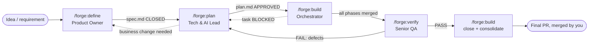

# The forge flow

forge splits feature delivery into four stages. Each one is a skill with one job, one artifact, and a human gate at the end. Nothing moves to the next stage until you approve it.

## Stages

| Stage | Answers | Never does | Gate you approve |
|---|---|---|---|
| **define** | WHAT is needed and WHY: rules, edge cases, inputs, outputs, notifications, differences from today | Write code, plan, or close the spec on its own | You declare `spec.md` **CLOSED** |
| **plan** | HOW: phases, tasks, files, agent/model/effort per task, parallelism, cost, branches, gates, rollback | Write code; change business rules without your approval | You approve `plan.md` |
| **build** | Executes the plan with parallel agents, commits per task, tests per task, golden comparison | Merge to the main branch, deploy, improvise outside the plan | One gate per phase (push, PR, merge to the feature branch), one at consolidation |
| **verify** | Does what was built match the spec, did anything else break, are the tests worth anything? | Fix code; take the expected result from the code | You accept the verdict (**PASS / PASS WITH OBSERVATIONS / FAIL**) |

## Handoffs

- **define → plan:** a `spec.md` in `CLOSED` status. If `plan` finds a business problem while mapping rules to code, it proposes the change, and with your approval reopens the spec (`REOPENED BY PLAN`), adjusts it, and closes it again.
- **plan → build:** an `APPROVED` `plan.md`. If a task cannot be done without changing the design, `build` marks it `BLOCKED` and sends you back to `plan`, which replans only what is pending.
- **build → verify:** all phases merged into `feature/<slug>`. `verify` can also run early, with the plan approved and nothing built yet, to turn test cases into acceptance criteria.
- **verify → plan:** on `FAIL`, `qa.md` has a *Handoff to plan* section (defects and cases to automate). `plan` turns it into a correction phase, `build` runs it, and `verify` re-tests.
- **verify → build (close):** on `PASS`, `build` closes the plan, consolidates the living functional docs, removes the feature's work folder, and opens the final PR. You do the merge.

## Sessions

Each skill recommends a **fresh session**. The artifacts carry all the context, and a long session re-sends its whole history on every message, so it costs more. Every skill can resume from its artifact (`spec.md` open questions, `plan.md` status, `progress.md` resume point, `qa.md` resume point).

See [artifacts.md](artifacts.md) for what each file contains and when it is removed, [conventions.md](conventions.md) for the fixed names, statuses and configuration, and [models-and-costs.md](models-and-costs.md) for model choices.
