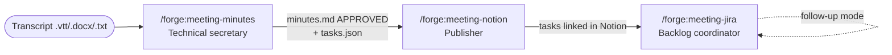

# The meetings flow

Besides feature delivery, forge ships three skills that turn a meeting transcript into validated minutes and keep the resulting tasks in sync with Notion and Jira. They are independent from `define → plan → build → verify`: they do not need a repo and do not read or write the forge work folder.

## Stages

| Stage | Does | Never does | Gate you approve |
|---|---|---|---|
| **meeting-minutes** | Cleans the transcript, diagnoses the meeting, proposes a menu of sections and builds only the chosen ones, with timestamped evidence | Write to Notion, Jira, email or Teams; invent owners, dates or agreements | You approve `minutes.md` (`APPROVED`) |
| **meeting-notion** | Publishes the minutes to the page you choose and syncs each task with your Notion tasks database | Decide on its own whether a task exists; delete or overwrite content; change the database schema without permission | Destination, format, and one decision per task (update / new / skip) |
| **meeting-jira** | Searches existing epics and issues, creates or updates what you decide, writes the keys back to Notion; in follow-up mode compares Notion and Jira | Create without searching first; delete issues; transition without per-issue confirmation | Epic per group, one decision per task, each transition |

## Files

Each meeting lives in `<minutes_folder>/<YYYY-MM-DD>-<slug>/`:

| File | Content | Written by |
|---|---|---|
| `transcript-clean.txt` | One line per turn: `[HH:MM:SS] Name: text` | `meeting-minutes` (script `scripts/clean_transcript.py`) |
| `minutes.md` | Front matter (`status: DRAFT \| APPROVED`) and the chosen sections | `meeting-minutes` |
| `tasks.json` | Tasks `T#` with owner, date, priority, evidence, and the `notion`/`jira` links | `meeting-minutes`; `notion`/`jira` fields by the other two |
| `log.md` | What was published or synced, when, with links | `meeting-notion`, `meeting-jira` |
| `follow-up-<date>.md` | Optional follow-up report | `meeting-jira` |

IDs in `minutes.md` (scoped to the minutes, unrelated to the IDs in `spec.md`): `D#` decisions, `A#` agreements, `T#` tasks, `P#` open questions, `R#` risks.

## Configuration

The three skills share a user-level file, `~/.claude/forge/meetings.json` (`%USERPROFILE%\.claude\forge\meetings.json` on Windows). It is created on first use, with your permission. Example: [skills/meeting-minutes/references/config-example.json](../skills/meeting-minutes/references/config-example.json).

| Key | Meaning |
|---|---|
| `minutes_folder` | Where meeting folders are created |
| `language` | Working language for the minutes, Notion pages and Jira issues. If missing, the repo's `Working language:` is used, or the skill asks once |
| `notion.destinations` | Destination page per topic |
| `notion.tasks_db` | Tasks database URL and property mapping |
| `jira.site`, `jira.project` | Default Atlassian site and project |
| `jira.status_mapping`, `jira.priority_mapping` | Notion ↔ Jira value mappings |

## Requirements

- `meeting-minutes`: Python 3 (standard library only) to clean `.vtt`/`.docx` files.
- `meeting-notion`: a Notion MCP server (claude.ai connector or `claude mcp add --transport http notion https://mcp.notion.com/mcp`).
- `meeting-jira`: the Atlassian MCP server (`claude mcp add --transport http atlassian https://mcp.atlassian.com/v1/mcp`). Notion is optional; without it, it works from `tasks.json`.
