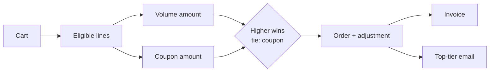

# Payments — Functional definition

> How it works **today**. Last updated: 2026-10-02 · `volume-discount` (PR #12)

## Purpose
Turns a cart into the amount the customer pays: line totals, at most one discount (volume or coupon), and the invoice. Serves every customer at checkout, accounting (adjustment records) and the store manager (top-tier alerts).

## Overall flow
1. Checkout prices the cart on every cart view and on confirmation (HTTP `POST /checkout/price`, `POST /checkout/confirm`).
2. Eligible lines are separated from excluded ones (gift cards).
3. The volume discount and the coupon discount (if a code was entered) are computed; the higher one is applied.
4. On confirmation the order and its adjustment are committed; the invoice is rendered.
5. After commit, a top-tier order triggers an email to the store manager.

## Current rules

### Amounts and rounding
| ID | Rule | Origin |
|---|---|---|
| `PAY-R1` | Amounts are integer cents; every percentage is rounded half up to the cent | `checkout-basics` R1 |

### Discounts
| ID | Rule | Origin |
|---|---|---|
| `PAY-R3` | Gift-card lines never receive a coupon discount | `coupon-codes` R3 |
| `PAY-R4` | Volume tier by eligible quantity Q: Q ≥ 50 → 15% · Q ≥ 25 → 10% · Q ≥ 10 → 5% · otherwise none | `volume-discount` R1 |
| `PAY-R5` | Gift-card lines do not count toward Q and are not part of the volume base; base = Σ unit price × quantity of eligible lines | `volume-discount` R2 |
| `PAY-R6` | The volume discount is computed once on the whole base and rounded half up to the cent (`PAY-R1`) | `volume-discount` R3 |
| `PAY-R7` | An order carries at most one discount: volume or coupon, the higher amount; on a tie, the coupon. Replaces `PAY-R2` | `volume-discount` R4 |

Replaced: `PAY-R2` ("a coupon code is the only discount an order can carry"), replaced by `PAY-R7` on 2026-10-02. See *Change history*.

### Invoice and records
| ID | Rule | Origin |
|---|---|---|
| `PAY-R8` | When the volume discount is applied, the invoice shows one negative line "Volume discount (N%)" after the subtotal; when the coupon wins, only the coupon line | `volume-discount` R5 |
| `PAY-S1` | The applied discount is stored as one `order_adjustments` row: `type` (`coupon` or `volume`), `percent`, `amount_cents` | `coupon-codes` S1, extended by `volume-discount` S2 |

### Notifications
| ID | Rule | Origin |
|---|---|---|
| `PAY-N1` | When an order is confirmed with the volume discount at 15% applied, the store manager gets "Top-tier order <id>" with eligible quantity, base, discount, total and lines | `volume-discount` N1 |

### Edge cases
| ID | Case → behavior | Origin |
|---|---|---|
| `PAY-C1` | Expired or unknown coupon → rejected with a message; the cart is priced without it | `coupon-codes` C1 |
| `PAY-C2` | Q exactly at 10, 25 or 50 → that tier applies | `volume-discount` C1 |
| `PAY-C3` | Gift cards that would reach a threshold are ignored (8 notebooks + 5 gift cards → no tier) | `volume-discount` C2 |
| `PAY-C4` | Coupon and volume amounts equal → coupon applied, no volume line | `volume-discount` C3 |
| `PAY-C5` | Manager email fails or no address configured → order confirmed, warning with order id logged, no retry | `volume-discount` C4 |

**Worked example (`PAY-R4`–`PAY-R8`):** 27 × $3.99 notebooks + 1 × $20.00 gift card, coupon fixed $8.00 → Q = 27 (10%), base 10,773 cents, volume 1,077 > coupon 800 → subtotal $127.73, "Volume discount (10%)" −$10.77, total $116.96.

## Data
- **Inputs:** cart lines (`sku`, `category`, `unit_price_cents`, `quantity`) from the checkout session; optional coupon code; store manager address from configuration.
- **Outputs:** invoice lines (PDF and order page); `order_adjustments` row (`order_id`, `type`, `percent`, `amount_cents`) read by accounting reports; manager email.

## Implementation
- **Component / entrypoints:** `checkout/api.py` → `price_cart` (`POST /checkout/price`), `confirm_order` (`POST /checkout/confirm`).
- **Key modules and functions:**
  - `checkout/money.py:percent_of`: half-up cent rounding (`PAY-R1`, `PAY-R6`).
  - `checkout/discounts/volume.py:tier_percent`, `eligible_lines`, `volume_discount`, `EXCLUDED_CATEGORIES`: `PAY-R4`–`PAY-R6`, `PAY-C2`, `PAY-C3`.
  - `checkout/coupons.py:validate_coupon`, `coupon_amount`: coupon rules (`PAY-R3`, `PAY-C1`).
  - `checkout/pricing.py:apply_discounts`: one discount, higher wins (`PAY-R7`, `PAY-C4`).
  - `checkout/invoice.py:build_invoice_lines`: discount line (`PAY-R8`).
  - `checkout/orders.py:save_adjustments`, `on_order_committed`: `PAY-S1` and post-commit hooks.
  - `checkout/notifications.py:notify_top_tier` + `checkout/templates/top_tier_email.txt`: `PAY-N1`, `PAY-C5`.
- **Queues, tables and storage:** table `order_adjustments` (one row per discounted order).
- **Environment variables:** `STORE_MANAGER_EMAIL` (recipient of `PAY-N1`), `MAIL_RELAY_URL` (outgoing mail relay used by `checkout/mailer.py`).
- **Error handling:** checkout errors use the existing service alerting; manager-email errors are logged as warnings with the order id and never fail the order.
- **Tests:**
  - `tests/checkout/test_money.py`: `PAY-R1`.
  - `tests/checkout/test_volume_discount.py`: `PAY-R4`–`PAY-R6`, `PAY-C2`, `PAY-C3`, half-cent rounding (`test_half_cent_rounds_up`).
  - `tests/checkout/test_coupons.py`: `PAY-R3`, `PAY-C1`.
  - `tests/checkout/test_pricing.py`: `PAY-R7`, `PAY-C4`.
  - `tests/checkout/test_invoice.py`: `PAY-R8`, `PAY-S1`.
  - `tests/checkout/test_notifications.py`: `PAY-N1`, `PAY-C5` (mailer mocked).
  - `tests/golden/checkout_totals/`: coupon-only totals, compared on every change to pricing.

## Operation
Deployed with the rest of the service (staging → production, by a person). After a pricing change, place a 50-unit order in staging and check the invoice line, the `order_adjustments` row and the manager email.

## Change history
| Date | Feature | PR / closing commit | Rule changes | Key decisions | QA | Real cost |
|---|---|---|---|---|---|---|
| 2026-03-10 | `checkout-basics` | #3 / `e4f1a90` | +PAY-R1 | Integer cents everywhere to avoid float drift | PASS | $3.10 |
| 2026-06-18 | `coupon-codes` | #7 / `9c2d5b8` | +PAY-R2, +PAY-R3, +PAY-S1, +PAY-C1 | One coupon per order, no stacking | PASS | $4.75 |
| 2026-10-02 | `volume-discount` | #12 / `a1b2c3d` | +PAY-R4, +PAY-R5, +PAY-R6, +PAY-R8, +PAY-N1, +PAY-C2–C5, ~PAY-S1 (type `volume`), −PAY-R2 (replaced by PAY-R7) | Higher discount wins, tie → coupon (customer chose it); discount on the whole base, not per line | PASS WITH OBSERVATIONS (OBS1: production mail relay checked after deploy; DEF1 half-cent rounding fixed) | $6.92 |
